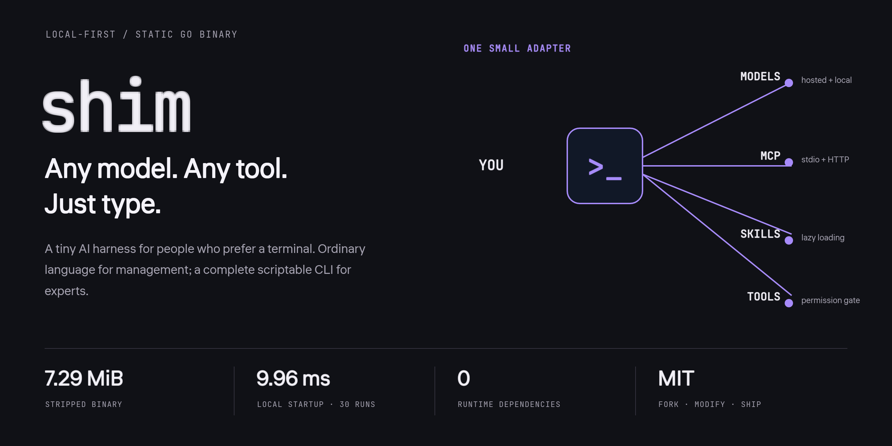
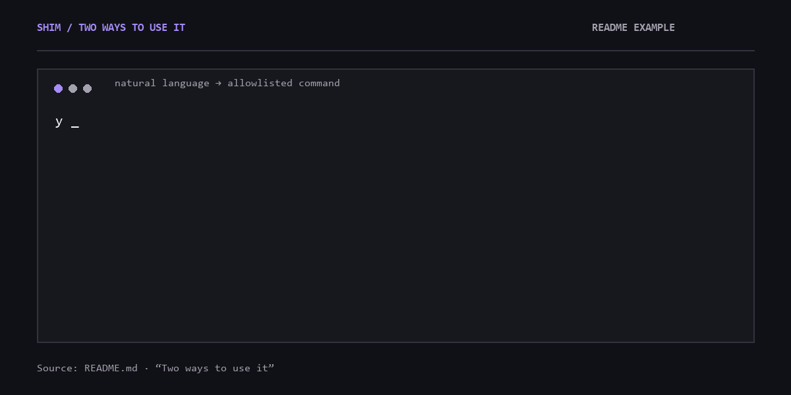
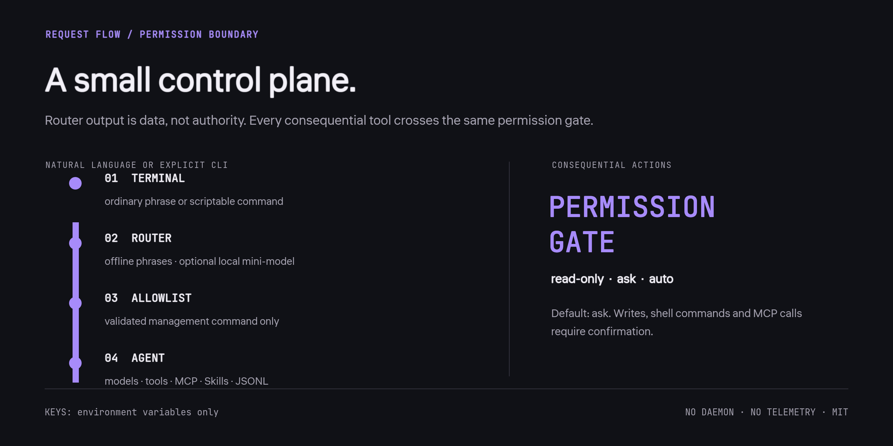

<div align="center">
  
  <p><strong>Любые модели. Любые инструменты. Просто напишите.</strong></p>
  <p><a href="README.md">English</a> · <a href="#быстрый-старт">Быстрый старт</a> · <a href="#два-режима">Два режима</a> · <a href="docs/ARCHITECTURE.md">Архитектура</a> · <a href="#важные-свойства">Безопасность</a></p>
</div>

Shim — крошечный локальный AI‑harness для терминала: один статический бинарник, ноль внешних зависимостей, никакого TUI, телеметрии и фонового демона. Лицензия MIT.

<div align="center">
  
  <p><sub>Документированный сценарий из README. Обычная фраза становится командой из allowlist; потенциально опасные действия требуют подтверждения.</sub></p>
</div>

## Быстрый старт

Скачайте бинарник из [Releases](https://github.com/Balanov/shim/releases) или установите через Go 1.25+:

```sh
go install github.com/Balanov/shim/cmd/shim@v0.1.0
shim setup
shim
```

PowerShell при запуске из текущей папки: `.\shim.exe setup`.

Setup находит Ollama, LM Studio и llama.cpp, предлагает выбрать модель и назначить локальную мини‑модель роутером обычных фраз. Веса моделей не скачиваются автоматически.

## Два режима

Для новичка — обычный текст:

```text
you › покажи модели
↳ /models

you › подключи локальную модель
↳ /discover --add
Выполнить эту команду? [y/N]
```

Для опытного пользователя — команды:

```sh
shim model discover --add
shim model add openrouter your/model --name main --use
shim skill add owner/repository
shim mcp add filesystem npx -y @modelcontextprotocol/server-filesystem .
shim run --read-only "объясни архитектуру репозитория"
shim run --yes "исправь тесты и проверь результат"
```

Полный список: `shim help`.

<div align="center">
  
  <p><sub>Результат роутера — данные, а не разрешение. Каждый consequential tool проходит общий permission gate. <a href="docs/ARCHITECTURE.md">Все инварианты архитектуры</a>.</sub></p>
</div>

## Важные свойства

- OpenAI‑совместимые API и Anthropic Messages; пресеты OpenAI, OpenRouter, Gemini, GitHub Models, Hugging Face, Ollama, LM Studio и llama.cpp.
- MCP over stdio и Streamable HTTP.
- Ленивая загрузка `SKILL.md` из `.shim/skills`, `.agents/skills`, `.claude/skills` и глобальной папки.
- Сессии JSONL, конфигурация JSON, ключи только из переменных окружения.
- Режимы `ask`, `read-only`, `auto`; по умолчанию опасные действия требуют подтверждения.
- Детерминированные offline‑фразы на русском и английском; другие языки — через выбранную локальную модель‑роутер и основную модель.

Shim не является песочницей ОС. Shell и MCP работают с правами пользователя; для недоверенного кода используйте контейнер или VM.

Полная документация, сравнение и ограничения — в [README.md](README.md). Архитектура — в [docs/ARCHITECTURE.md](docs/ARCHITECTURE.md).

[MIT](LICENSE): форкайте, меняйте и публикуйте свои версии.
